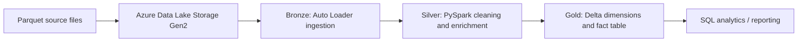

# End-to-End Retail Data Engineering Pipeline | Azure Databricks

**A medallion-architecture data pipeline that ingests retail datasets, transforms them with PySpark, and builds analytics-ready Delta Lake tables.**

**Tech stack:** Azure Databricks · PySpark · Spark SQL · Azure Data Lake Storage Gen2 · Delta Lake · Databricks Auto Loader · Delta Live Tables (DLT)

## Project overview

Retail data is often distributed across customers, products, orders, and regions. This project demonstrates an end-to-end approach to bringing those datasets into a consistent, queryable analytical model using **Bronze → Silver → Gold** layers.

The supplied Databricks notebook export includes parameter-driven ingestion, cleansing and enrichment, Delta tables, incremental merge patterns, customer dimension management, product change tracking, and an orders fact table.

## Architecture



| Layer | Purpose | Implementation |
| --- | --- | --- |
| **Bronze** | Land incoming data with minimal transformation | Auto Loader (`cloudFiles`), streaming writes, schema and checkpoint locations |
| **Silver** | Prepare consistent business-ready records | PySpark transformations, timestamp conversion, derived attributes, Delta output |
| **Gold** | Model data for downstream analysis | Customer and product dimensions, orders fact table, Delta `MERGE` |

## Key features

- **Configurable ingestion:** A notebook widget selects the dataset, allowing the same Bronze notebook to process customers, products, or orders.
- **Incremental file processing:** Auto Loader reads Parquet inputs from cloud storage and uses checkpoints to track progress.
- **Data transformation:** Silver notebooks standardize fields, create customer full names, derive email domains, convert order timestamps, and calculate order year.
- **Advanced Spark operations:** Window functions demonstrate `dense_rank`, `rank`, and `row_number`; SQL/Python functions support reusable transformations.
- **Customer dimension:** Implements a **Type 1 slowly changing dimension (SCD)** pattern with surrogate keys and Delta merges.
- **Product dimension:** Demonstrates a **Type 2 SCD** pipeline with Delta Live Tables, change application, and non-null data quality expectations.
- **Orders fact table:** Joins order records with customer and product dimension keys, then performs an upsert using Delta Lake.

## Data model

The sample inputs cover four retail entities:

| Dataset | Role in the pipeline |
| --- | --- |
| `customers` | Customer attributes for the customer dimension |
| `products` | Product attributes for the product dimension |
| `orders` | Transaction records for the orders fact table |
| `regions` | Regional reference data prepared in Silver |

The uploaded sample files include first and second batches for customers, products, and orders, plus a regions file. These can be used to demonstrate ingestion across multiple file drops.

## Repository structure

```text
.
├── README.md
├── Databricks ETE Project.dbc       # Databricks workspace notebook archive
├── customer_first.parquet
├── customers_second.parquet
├── products_first.parquet
├── products_second.parquet
├── orders_first.parquet
├── orders_second.parquet
└── regions.parquet
```

**Notebooks inside the `.dbc` archive:** `parameters`, `Bronze_Layer`, `Silver_Customers`, `Silver_Products`, `Silver_Orders`, `Silver_Regions`, `Gold_Customers`, `Gold Products`, and `Gold Orders`.

## How to explore or run

1. Import **`Databricks ETE Project.dbc`** into an Azure Databricks workspace using the workspace import option.
2. Provision or connect Azure Data Lake Storage Gen2 and configure Databricks access to it.
3. Update the hard-coded `abfss://` paths and catalog/schema names in the notebooks to match your environment. The original notebooks refer to an example storage account and catalog; these are **not portable defaults**.
4. Upload the Parquet sample files into the appropriate source folders, grouped by dataset (`customers`, `products`, `orders`, `regions`).
5. Review and execute the parameter and Bronze ingestion notebooks, followed by the relevant Silver notebooks.
6. Create the required catalog and schemas, then execute the Gold customer and orders notebooks. Configure the Gold product DLT pipeline separately in a compatible Databricks environment.
7. Inspect the resulting Delta tables and validate record counts, key relationships, and expected updates.

> **Execution note:** The archive contains workspace-specific notebook code, not a one-click deployment package. Some cells assume pre-existing tables, permissions, widgets, or pipeline configuration. Review notebook dependencies and cell order before running. No end-to-end runtime benchmark or independently verified deployment result is claimed here.

## Technical highlights for recruiters

This project showcases practical familiarity with:

**Data engineering:** ingestion patterns, cloud storage integration, medallion architecture, batch/streaming concepts, schema management, and Delta Lake.

**Data modeling:** dimensional tables, surrogate keys, fact-table joins, SCD Type 1/Type 2, and incremental upserts.

**Spark and SQL:** DataFrame APIs, window functions, UDFs, data quality rules, and parameterized notebook workflows.

## Future improvements

- Add an orchestrated Databricks Workflow with explicit task dependencies and retry policies.
- Add automated data quality checks, reconciliation tests, and pipeline monitoring.
- Move environment-specific storage and catalog values into configuration or secrets.
- Add architecture screenshots, sample SQL queries, and a dashboard built from Gold tables.

---

**Project type:** Portfolio / hands-on data engineering project  
**Primary platform:** Azure Databricks  
**Focus:** Scalable data ingestion, transformation, and analytical modeling
